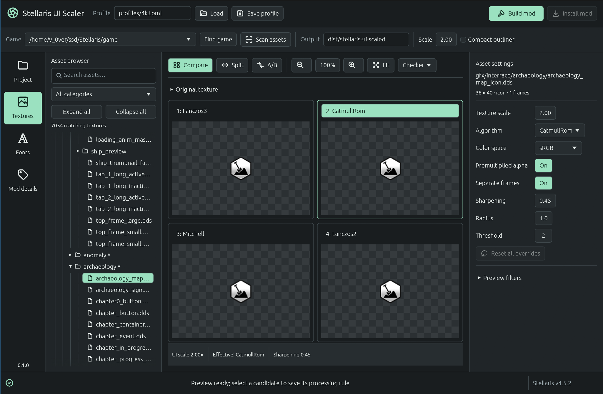

# Stellaris UI Scaler

**English** | [Русский](README.ru.md)



Create a mod with a larger Stellaris interface: scale UI elements, textures, and fonts without changing the game files. Includes a graphical interface and a CLI.

## Installation

Download a **Windows or Linux** build from the repository's **Releases**, extract the archive, and run `stellaris-ui-scaler` (`stellaris-ui-scaler.exe` on Windows). Keep the included `profiles` and `ai` directories alongside the executable.

Prebuilt binaries require an x86-64-v3 CPU with AVX2/FMA. Linux builds require glibc 2.39 or newer and X11/Wayland and OpenGL libraries for the GUI.

## Create a mod

1. In **Project**, select your Stellaris installation directory and click **Scan assets**. Use **Find game** or enter the path manually if needed.
2. Set **Scale**, such as `2.0` to double the size, and **Output directory**, where the mod will be stored.
3. Optionally, adjust **Textures**, **Fonts**, and the name and picture in **Mod details**. Click **Save profile** to keep your settings.
4. Click **Build mod** and wait for it to finish.
5. In **Mod details**, check **Mods directory** (the `mod` folder in your Stellaris user data) and click **Install mod**. Keep **Output directory** in place: the installed mod refers to it.
6. Restart the Stellaris launcher, enable the generated mod in your playset, and set **UI Scaling = 1.0** in the game.

After changing settings, rebuild and install the mod again.

## Fonts and other UI mods

In **Fonts**, select **Sharp text (TrueType)** for sharper text in supported fonts, or **Original fonts** to preserve the original typefaces. Adjust **Text size** separately if needed. Texture previews help you check scaling and sharpening before building.

**Scan assets** detects enabled UI mods from the launcher's exported configuration. In **Project → Source UI mods**, uncheck any mods you want to exclude, then scan again. To use only the base game's interface, uncheck all rows.

Keep source mods enabled in the launcher and load the generated mod after them. Mods are processed in load order; later mods override files with matching paths. Other UI mods may conflict, so check the result in the game.

After changing your playset, refresh the launch configuration through the launcher and scan again. Only unpacked mods are supported; archived mods and `replace_path` overrides affecting UI resources are not supported. For a custom user data location, set **Source UI mods → User data directory**.

## Install from source

Requires Rust nightly and a system build toolchain, plus the GUI libraries listed above on Linux. From the repository root:

```bash
cargo install --path . --locked
stellaris-ui-scaler
```

For a CLI-only installation, add `--no-default-features`. Run `stellaris-ui-scaler --help` for available commands.

## RealPLKSR 2x

Choose **RealPLKSR 2x** in the texture algorithm or preview candidates, or load `profiles/4k_realplksr_2x.toml`. Disable **Auto algorithm** when selecting it as the default. You can also apply it to individual categories, directories, or textures.

This mode uses AI to enlarge textures and runs locally on CPU. It is slower than the other filters. Start with sharpening set to zero and compare the preview before applying it broadly.

Release archives include everything needed for this mode. Keep the `ai` directory alongside the executable. No internet connection or Python installation is needed to use it.

## Command line

Run `stellaris-ui-scaler --help` for available commands. To see a command's options, add `--help`, for example `stellaris-ui-scaler build --help`.

## Credits

Inspired by [Hayneken's mod](https://steamcommunity.com/sharedfiles/filedetails/?id=3801492978).
