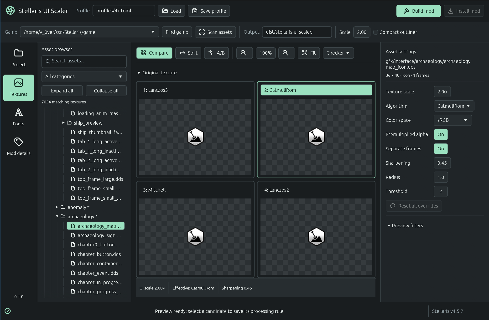

# Stellaris UI Scaler

[English](README.md) | **Русский**



Программа создаёт мод с увеличенным интерфейсом Stellaris: масштабирует элементы UI, текстуры и шрифты, не изменяя файлы игры. Доступны графический интерфейс и CLI.

## Установка

Скачайте сборку для **Windows или Linux** из раздела **Releases** репозитория, распакуйте архив и запустите `stellaris-ui-scaler` (`stellaris-ui-scaler.exe` в Windows). Оставьте каталоги `profiles` и `ai` рядом с исполняемым файлом.

Готовые сборки требуют процессор x86-64-v3 с AVX2/FMA. Для Linux нужны glibc 2.39 или новее, а для графического интерфейса — библиотеки X11/Wayland и OpenGL.

## Как создать мод

1. На вкладке **Project** выберите каталог установленной Stellaris и нажмите **Scan assets**. При необходимости используйте **Find game** или введите путь вручную.
2. Задайте **Scale**, например `2.0` для увеличения вдвое, и **Output directory**, где будет храниться мод.
3. При необходимости настройте **Textures**, **Fonts**, название и картинку в **Mod details**. Нажмите **Save profile**, чтобы сохранить настройки.
4. Нажмите **Build mod** и дождитесь завершения сборки.
5. В **Mod details** проверьте **Mods directory** — каталог `mod` в пользовательских данных Stellaris — и нажмите **Install mod**. Не перемещайте и не удаляйте **Output directory**: установленный мод ссылается на него.
6. Перезапустите лаунчер Stellaris, включите созданный мод в своём playset и установите в игре **UI Scaling = 1.0**.

После изменения настроек пересоберите и установите мод заново.

## Шрифты и другие UI-моды

В **Fonts** выберите **Sharp text (TrueType)** для более чёткого текста в поддерживаемых шрифтах или **Original fonts** для сохранения исходных гарнитур. При необходимости отдельно настройте **Text size**. Предпросмотр текстур позволяет оценить масштабирование и резкость до сборки.

**Scan assets** обнаруживает включённые UI-моды из экспортированной конфигурации лаунчера. В **Project → Source UI mods** снимите галочки с модов, которые нужно исключить, и повторите сканирование. Для интерфейса базовой игры снимите все галочки.

Оставьте исходные моды включёнными в лаунчере и загружайте созданный мод после них. Моды обрабатываются в порядке загрузки: каждый следующий заменяет файлы с совпадающими путями. Другие UI-моды могут конфликтовать, поэтому проверьте результат в игре.

После изменения playset обновите конфигурацию запуска через лаунчер и повторите сканирование. Поддерживаются только распакованные моды; архивные моды и переопределения `replace_path`, затрагивающие интерфейс, не поддерживаются. При нестандартном расположении пользовательских данных укажите **Source UI mods → User data directory**.

## Установка из исходников

Нужны Rust nightly и системный инструментарий сборки, а в Linux — также указанные выше библиотеки для графического интерфейса. Из корня репозитория:

```bash
cargo install --path . --locked
stellaris-ui-scaler
```

Для установки только CLI добавьте `--no-default-features`. Список команд: `stellaris-ui-scaler --help`.

## RealPLKSR 2x

Выберите **RealPLKSR 2x** в алгоритме обработки текстур или кандидатах предпросмотра либо загрузите `profiles/4k_realplksr_2x.toml`. Для выбора алгоритма по умолчанию отключите **Auto algorithm**. Его также можно применить к отдельным категориям, каталогам или текстурам.

Этот режим увеличивает текстуры с помощью нейросети и работает локально на CPU. Он медленнее остальных фильтров. Начните с нулевой резкости и сравните предпросмотр перед массовым применением.

Готовые сборки содержат всё необходимое для этого режима. Оставьте каталог `ai` рядом с исполняемым файлом. Для работы не нужны интернет и установленный Python.

## Командная строка

Выполните `stellaris-ui-scaler --help`, чтобы увидеть список команд. Для просмотра параметров команды добавьте `--help`, например `stellaris-ui-scaler build --help`.

## Благодарности

Проект создан с учётом [мода Hayneken](https://steamcommunity.com/sharedfiles/filedetails/?id=3801492978).
